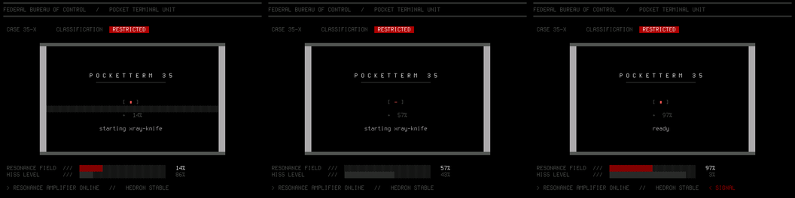
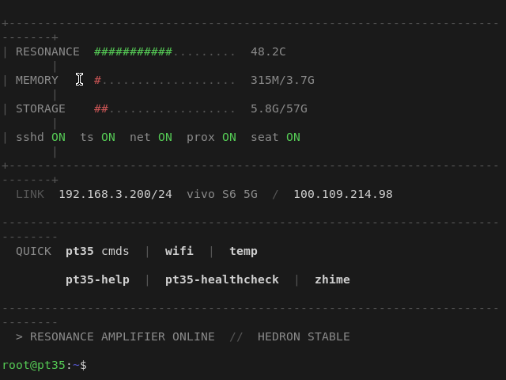

# pt35 — PocketTerm35 Linux customizations

**English** · [中文](README.zh-CN.md)

> Handheld Raspberry Pi terminal: minimal Chinese desktop, CRT-style boot animation,
> and a toolchain for detecting/repairing SD-card filesystem corruption.

Built and tested on a **Waveshare PocketTerm35** (Raspberry Pi 4B, aarch64, Arch Linux ARM).
Everything here is real, deployed, and verified on the device — including the mistakes.

---

## What this is

A handheld Pi terminal running Arch Linux ARM with:

- **A minimal Chinese desktop** — sway + foot + fcitx5, no panel, no wallpaper, ~50 MB RAM.
  kmscon stays on tty1 as a rescue console; the desktop owns tty2.
- **A CRT-glitch boot splash** — animated ASCII art in the visual language of
  *Control: Resonance* (brutalist slab, single saturated red, periodic signal loss),
  driven by **real systemd service state**, not a fake progress bar.
- **A zero-fork MOTD** — 17 lines × 78 columns institutional-terminal welcome page
  rendered in 245 ms on a Pi 4B.
- **A repair toolchain** — this device ate its own filesystem **7 times** from unclean
  shutdowns. The tools here find corruption that `fsck` and `ldd` cannot.

All 16 commands share one metadata-driven help system:

```bash
pt35                 # list every command, grouped
pt35-help wifi       # detailed usage, extracted from the script itself
pt35 <TAB>           # bash completion
man pt35-help        # man page
```

---

## Screenshots

| Boot animation | MOTD |
|---|---|
|  |  |

Full animation: [`assets/control-resonance.gif`](assets/control-resonance.gif) ·
glitch version: [`assets/control-tv-glitch.gif`](assets/control-tv-glitch.gif)

---

## Layout

```
bin/       16 commands (all with `# help:` metadata)
systemd/   unit files (incl. the fixes for two real races)
config/    foot.ini, sway config, fcitx5 profile, pt35.conf.example
tools/     filesystem corruption detection & repair (Python, stdlib only)
docs/      8 write-ups — the findings, not just the recipes
assets/    screenshots
```

---

## Install

```bash
git clone <this-repo> pt35 && cd pt35
sudo ./install.sh --dry-run     # show what would happen
sudo ./install.sh               # do it
```

`install.sh` is idempotent, backs up anything it overwrites, and refuses to run on
non-aarch64 / missing-hardware unless you pass `--force`.

---

## The three findings worth your time

These cost the most time to diagnose, and apply to **any** Linux terminal UI project —
not just this hardware.

### 1. Block characters are double-width

`█ ▓ ▒ ░ ▄ ▀` are **not** in DejaVu Sans Mono. Your terminal falls back to a CJK font,
where they render **2 cells wide**. Measured on the device:

| Content | Chars | Measured px | Cells |
|---|---|---|---|
| `▓` × 10 | 10 | 108 | **13.4** |
| `▄` × 10 | 10 | 197 | **24.6** |
| `X` × 20 | 20 | 160 | **20.0** ✅ |

Every column calculation silently breaks. **Use pure ASCII** for anything you need to align.
→ [`docs/07-开机动画设计.md`](docs/07-开机动画设计.md)

### 2. `ldd` cannot detect a corrupted library

When an unclean shutdown loses dirty pages, files end up with the **correct size and a
valid ELF header but wrong contents**. `ldd` succeeds. The binary loads. It then aborts:

```
LLVM ERROR: out of memory      ← reported as OOM
Allocation failed                 but 3.2 GB was free
Aborted (core dumped)          ← sway's renderer init
```

The only reliable detector is a **checksum**:

```bash
pacman -Qkk llvm-libs
# llvm-libs: /usr/lib/libLLVM.so.23.1 (SHA256 checksum mismatch)
```
→ [`docs/06-SD卡损坏的识别与定位.md`](docs/06-SD卡损坏的识别与定位.md)

### 3. `/run/user/$UID` is destroyed when the last session ends

A Wayland compositor's socket lives in `$XDG_RUNTIME_DIR`. When root has no lingering
and you disconnect the last SSH session, systemd **destroys and recreates** `/run/user/0`:

```
16:59:40 Stopping User Runtime Directory /run/user/0...
16:59:44 Starting User Runtime Directory /run/user/0...   ← recreated, empty
```

The compositor keeps running; every client now fails to connect. Move it:

```ini
[Service]
RuntimeDirectory=pt35
Environment=XDG_RUNTIME_DIR=/run/pt35
```
→ [`docs/08-系统深挖与Bug修复.md`](docs/08-系统深挖与Bug修复.md)

---

## Other documented pitfalls

| Symptom | Cause | Where |
|---|---|---|
| Desktop starts, then dies ~45 s later | `getty@tty1` grabbed tty1; `Conflicts=` killed the desktop. `disable` is not enough — use `mask` | [docs/08](docs/08-系统深挖与Bug修复.md) |
| `systemctl restart <desktop>` leaves it dead | start+stop in the same second; the compositor's `wait` blocks past `TimeoutStopSec` | [docs/08](docs/08-系统深挖与Bug修复.md) |
| Terminal UI takes 2.3 s to draw | Per-character `$(...)` in the width function — thousands of forks. Cache + pure-bash stripping → 245 ms | [docs/07](docs/07-开机动画设计.md) |
| `fc-list "Font:charset=..."` lies | It matches the *family*, not the file. Verify glyphs by rendering and reading back the framebuffer | [docs/07](docs/07-开机动画设计.md) |
| SSH authenticates then closes instantly | `libkrb5` corruption → `SIGILL` in sshd | [docs/04](docs/04-系统库损坏与离线恢复.md) |
| Touchscreen works but typing doesn't (or vice versa) | `libinput` device order after a driver change | [docs/01](docs/01-系统优化与排障.md) |

---

## Configuration

Copy the template and edit:

```bash
sudo install -m644 config/pt35.conf.example /etc/pt35.conf
```

```ini
STATIC_IP=192.168.1.100/24
STATIC_GW=192.168.1.1
FAN_GPIO=14
TEMP_WARN=55
```

Nothing in this repo contains real credentials, hostnames, or addresses.
`./check-secrets.sh` enforces that — run it before committing.

---

## Hardware notes

- **Display**: HDMI→DPI 640×480. Foot at `DejaVu Sans Mono:size=11` gives **80×24**
  (do not infer this from font metrics — measure with `tput`).
- **Fan**: GPIO14 has **no hardware PWM**; software PWM via `pwm-gpio-fan`.
- **Keyboard**: an RP2040 running CircuitPython over USB OTG. Remapping is done on the
  Linux side via evdev/uinput, because the stock firmware's `boot.py` disables the USB
  drive that would let you edit `code.py`.
- **No PCIe** on the Pi 4B — M.2 storage is only possible over USB.

---

## License

MIT — see [LICENSE](LICENSE).

Vendor materials (Waveshare schematics, 3D models, device-tree overlays) are **not**
included; see [`docs/`](docs/) for links instead. Third-party community projects are
linked, never vendored.
